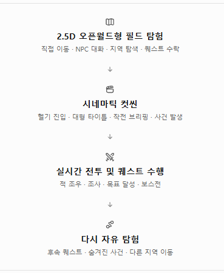

# 핵심 게임 흐름 (확정, 2026-10-20)

어빌리티킹덤은 아래 네 단계를 도는 구조로 간다. 사용자가 정한 방향이며, 새 기능·화면은 이 흐름 안에서 어디에 들어가는지부터 정한다.

1. **2.5D 오픈월드형 필드 탐험** — 직접 이동 · NPC 대화 · 지역 탐색 · 퀘스트 수락
   - 필드에서는 NPC뿐 아니라 **다른 유저도 만난다**(같은 필드에 다른 유저가 함께 보인다).
2. **시네마틱 컷씬** — 헬기 진입 · 대형 타이틀 · 작전 브리핑 · 사건 발생
3. **실시간 전투 및 퀘스트 수행** — 적 조우 · 조사 · 목표 달성 · 보스전
4. **다시 자유 탐험** — 후속 퀘스트 · 숨겨진 사건 · 다른 지역 이동

## 지금 구현과의 대응

| 단계 | 지금 있는 것 | 비고 |
|---|---|---|
| 1. 필드 탐험 | `screens/story/StoryField.tsx` + `explore/ExploreRenderer.ts`: 아카데미 구역(정문 광장·아래 정원·벚꽃 연못), 8방향 이동, NPC 대화, 조사 지점, 미니맵 | 퀘스트 수락은 표시만(퀘스트 진행 데이터 없음). **다른 유저 표시는 아직 없음** |
| 2. 시네마틱 컷씬 | `ui/cine/Cine.tsx`: 장 진입 대형 타이틀, 카메라 돌진, 구역 이름(Control식), 전투 시작·보스 단계 타이틀 | 헬기 진입·작전 브리핑 컷은 아직 없음 |
| 3. 실시간 전투·퀘스트 | `screens/case/CaseBattle.tsx` + `game/combat/sim.ts`: 1장 사건 전투(일반·목표·보스), 조사(`StoryScene`) | 필드에서 전투로 넘어가는 연결은 아직 없음(사건 파일에서 들어감) |
| 4. 다시 자유 탐험 | 필드로 돌아오는 흐름 없음 | 후속 퀘스트·숨겨진 사건·다른 지역 이동 모두 미구현 |

## 다른 유저와 만나는 필드 — 구현에 필요한 것

지금 게임은 서버 없이 기기 안에서만 돈다(`game/localService.ts`). 다른 유저를 필드에 보이게 하려면 다음이 필요하다.

- **실시간 접속 서버:** 같은 구역에 있는 유저들의 위치·방향·캐릭터를 주고받는 통로(웹소켓 등)
- **구역 나누기(채널):** 한 구역에 보이는 인원 상한과 채널 배정
- **보이는 정보:** 캐릭터 외형(탐색 스프라이트), 닉네임, 이동·멈춤 상태. 렌더러는 이미 여러 인물을 그리므로(`Actor[]`) 다른 유저를 같은 방식으로 얹을 수 있다
- **계정·로그인:** 유저를 구분할 계정(지금은 기기 저장만 있음)

아직 정하지 않은 것(사용자 결정 필요): 한 구역 인원 상한, 유저끼리 할 수 있는 것(인사·파티·거래·대결 등), 컷씬·전투 중에 다른 유저가 보이는지, 서버 운영 방식.
